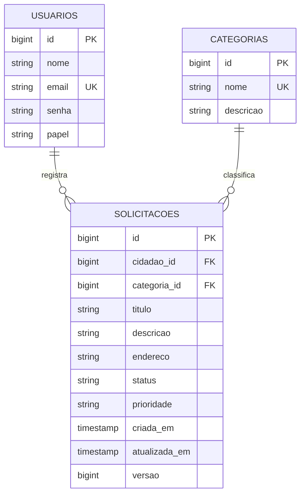

# Bairro em Dia

API REST CitizenTech para registrar problemas de zeladoria urbana e acompanhar o atendimento. O morador informa o problema e consulta suas solicitações. O gestor organiza categorias, define prioridades e atualiza o status do atendimento.

## Integrante

Nome completo, RM e turma devem ser preenchidos pelo integrante antes da entrega, conforme o formato solicitado pelo professor.

## Pitch

Link do vídeo pendente de gravação e publicação pelo integrante. Inserir aqui o endereço público ou não listado antes da entrega.

## Problema e impacto

Moradores precisam de um fluxo simples para registrar problemas como postes apagados, buracos e descarte irregular, com acompanhamento do atendimento. A proposta centraliza o registro e permite medir quantidades por status. O cidadão beneficiado é o morador do bairro, incluindo pessoas afetadas pela falta de iluminação e pela dificuldade de circulação.

A solução contribui para o ODS 11, ao apoiar o cuidado com espaços urbanos, e para o ODS 9, por oferecer infraestrutura digital para registro e acompanhamento. Indicadores propostos incluem solicitações resolvidas, proporção de resoluções e tempo entre abertura e atualização final. Os dados de demonstração são fictícios.

## Tecnologias

Java 21, Maven 3.9+, Spring Boot 3.5.7, Spring Web, Spring Data JPA, Bean Validation, Spring Security, JWT HS256, Spring HATEOAS, Swagger/OpenAPI e Flyway. PostgreSQL 17 no ambiente Docker. H2 em arquivo para execução local rápida.

## Executar localmente

Instale um **JDK 21** completo e o Maven 3.9 ou superior. Abra o projeto pela pasta que contém `pom.xml` no IntelliJ, ou use o terminal nessa pasta.

```bash
mvn clean package
java -jar target/bairro-em-dia-1.0.0.jar
```

Também é possível executar `BairroEmDiaApplication` pela IDE ou usar `mvn spring-boot:run`. O perfil padrão `local` cria o banco H2 em `./data/bairro`. O Flyway cria as tabelas na primeira execução. Os registros permanecem após reiniciar a aplicação, desde que a mesma pasta de trabalho seja utilizada.

Abra http://localhost:8080/swagger-ui.html. O JSON OpenAPI está em http://localhost:8080/v3/api-docs.

### Usuários locais de demonstração

| Papel | E-mail | Senha fictícia do perfil local |
|---|---|---|
| GESTOR | gestor@bairro.test | GestorDemo123! |
| CIDADAO | cidadao@bairro.test | CidadaoDemo123! |

Essas credenciais servem à demonstração local. O perfil PostgreSQL exige segredo JWT e senha do banco por variáveis. A carga de usuários de demonstração nesse perfil é opcional e usa as senhas definidas no ambiente.

### Usar o Swagger

1. Execute `POST /api/auth/login` com e-mail e senha de demonstração.
2. Copie apenas o valor de `accessToken` da resposta.
3. Clique em **Authorize**, cole o token e confirme.
4. Execute os endpoints protegidos. Para comparar permissões, faça login com o outro papel e substitua o token no Authorize.

```json
{"email":"cidadao@bairro.test","senha":"CidadaoDemo123!"}
```

## Executar API e PostgreSQL com Docker

Instale Docker Engine com Compose ou Docker Desktop. Copie `.env.example` para `.env` e substitua os valores indicados. Use uma chave JWT aleatória com ao menos 32 bytes. As senhas dos usuários de demonstração devem ter ao menos 8 caracteres e no máximo 72 bytes em UTF-8.

```bash
cp .env.example .env
docker compose up -d --build
docker compose ps
docker compose logs --tail=100 api
```

No PowerShell, a cópia também pode ser feita com `Copy-Item .env.example .env`. O arquivo `.env` é ignorado pelo Git. O Compose define o perfil `postgres`, aguarda a saúde do banco e conecta os serviços pela rede `bairro`. A API roda como usuário `app`, com diretório `/app`. O PostgreSQL persiste no volume nomeado `dados-bairro`. Sua porta é vinculada ao loopback do host para consulta local.

```bash
docker compose exec api id
docker compose exec api pwd
docker compose exec banco psql -U bairro -d bairro -c "SELECT id, titulo, status, categoria_id, cidadao_id FROM solicitacoes;"
docker compose restart api
```

Depois do reinício, consulte o mesmo registro pela API e pelo SELECT. `docker compose down` encerra os serviços e preserva o volume. A opção `-v` apaga o volume e seus dados.

Para executar Java diretamente contra um PostgreSQL já disponível, defina `SPRING_PROFILES_ACTIVE=postgres`, `DB_URL`, `DB_USER`, `DB_PASSWORD` e `JWT_SECRET` antes de iniciar o JAR. As tabelas também são criadas pelo Flyway nesse perfil.

## Endpoints

| Método | Rota | Acesso e finalidade |
|---|---|---|
| POST | /api/auth/cadastro | Público, cadastro de cidadão |
| POST | /api/auth/login | Público, emissão de JWT |
| GET | /api/auth/me | Usuário autenticado |
| GET | /api/categorias | Autenticado, lista paginada |
| GET | /api/categorias/{id} | Autenticado, consulta individual |
| POST | /api/categorias | Gestor, criação |
| PUT | /api/categorias/{id} | Gestor, atualização |
| DELETE | /api/categorias/{id} | Gestor, exclusão sem vínculos |
| GET | /api/solicitacoes | Lista paginada e filtrada pelo acesso |
| GET | /api/solicitacoes/resumo | Contagens por status respeitando o acesso |
| GET | /api/solicitacoes/{id} | Dono ou gestor |
| POST | /api/solicitacoes | Autenticado, registro associado ao próprio usuário |
| PUT | /api/solicitacoes/{id} | Dono ou gestor, solicitação aberta |
| PATCH | /api/solicitacoes/{id}/atendimento | Gestor, status e prioridade |
| DELETE | /api/solicitacoes/{id} | Dono ou gestor, solicitação aberta |

Exemplo de criação de solicitação. Consulte primeiro uma categoria para obter o identificador existente.

```json
{
  "titulo": "Buraco na calçada",
  "descricao": "Calçada danificada próximo ao ponto de ônibus.",
  "endereco": "Rua de Demonstração, 150 - Centro",
  "categoriaId": 1
}
```

Exemplo de atendimento pelo gestor.

```json
{"status":"EM_ATENDIMENTO","prioridade":"ALTA"}
```

Os status disponíveis são `ABERTA`, `EM_ATENDIMENTO`, `RESOLVIDA` e `CANCELADA`. As prioridades são `BAIXA`, `MEDIA` e `ALTA`.

Filtros combináveis por `categoriaId`, `status` e `termo` (parte do título). Exemplo `GET /api/solicitacoes?status=ABERTA&termo=poste&page=0&size=10&sort=criadaEm,desc`. O limite de página é de 100 registros. Campos de ordenação permitidos estão descritos no Swagger. Os links paginados usam `self`, `first`, `next`, `prev` e `last` quando aplicáveis.

## Modelagem e relacionamentos



`Solicitacao` usa dois relacionamentos `ManyToOne`, com carregamento `LAZY` e chaves estrangeiras obrigatórias. O mapeamento para DTO ocorre dentro das transações. A associação não usa cascade de remoção, pois excluir uma solicitação deve preservar seu autor e sua categoria. O banco impede exclusões de registros referenciados. `@Version` detecta alterações concorrentes e a API responde 409 quando há conflito. Os DTOs impedem exposição do hash da senha.

## Regras de negócio e segurança

O cadastro público define sempre `CIDADAO`. O cliente não escolhe papel, autor, status inicial ou prioridade inicial. O usuário da solicitação vem do JWT. O cidadão consulta apenas seus próprios registros, inclusive nos filtros e no resumo. O gestor consulta todos e possui acesso às operações de categoria e atendimento.

Uma solicitação nasce `ABERTA`, com prioridade `MEDIA`. Seu conteúdo pode ser editado ou excluído enquanto estiver aberta. O atendimento segue `ABERTA → EM_ATENDIMENTO → RESOLVIDA`. O cancelamento pode ocorrer em `ABERTA` ou `EM_ATENDIMENTO`. Repetir o mesmo status é aceito e permite ajustar a prioridade. A API rejeita reabertura e conclusão direta de uma solicitação aberta.

As senhas são armazenadas com BCrypt. Os JWT têm emissor validado, assinatura HS256 e validade de uma hora. Envie o token no cabeçalho `Authorization: Bearer TOKEN`. CORS usa origens configuráveis por `CORS_ORIGINS`, separadas por vírgulas. As requisições são sem sessão. Use HTTPS no ambiente publicado.

Criação responde 201, com Location nos recursos de categoria e solicitação. Consultas e atualizações respondem 200, exclusões 204. Dados inválidos respondem 400, autenticação inválida 401, acesso negado 403, registro inexistente 404 e conflitos de negócio ou integridade 409. Os erros usam `application/problem+json`; erros de validação incluem os campos inválidos.

## Justificativa das consultas

| Consulta | Aplicação e motivo |
|---|---|
| Query method `findByEmail` | Login e busca por e-mail normalizado, com unicidade no banco |
| Query method `countByCidadaoIdAndStatus` | Contagem de abertas para o cidadão sem carregar registros completos |
| Query method `existsByCategoriaId` | Impede excluir uma categoria em uso |
| JPQL `contarPorStatus` | Agrega o resumo por status, com filtro opcional de autor |
| Specification `filtrar` | Combina autor, categoria, status e título sem criar métodos para cada combinação |

As consultas usam parâmetros. A pesquisa por título trata `%` e `_` como caracteres literais, e a ordenação aceita apenas campos listados. O banco possui índices nas chaves estrangeiras e no status para apoiar as consultas mais frequentes.

## HATEOAS

As respostas individuais contêm links para o próprio recurso, sua coleção e recursos relacionados. Os links de edição e exclusão de solicitações aparecem quando o status permite essas ações. O link de atendimento aparece para gestores. As categorias oferecem links para suas solicitações filtradas. A autorização também é conferida no servidor.

## Escopo atualizado da disciplina

Conforme orientação trazida pelo integrante em 18/11/2026 a partir de conversa da turma, cache, Actuator e consumo pelo app Mobile foram dispensados. Essa interpretação deve ser confrontada com a orientação final do professor. As demais exigências de Java foram mantidas. A entrega Mobile seguirá seu próprio escopo de protótipo.

## Uso de IA

ChatGPT/Codex foi utilizado para estruturar o projeto, implementar código, revisar regras, preparar documentação e verificar o funcionamento. O integrante deve revisar e compreender a implementação e declarar esse apoio na apresentação.

## Verificação realizada em 18/11/2026

Compilação e empacotamento com JDK 21 e Maven concluídos. Foram executadas 41 verificações HTTP no perfil local, cobrindo login, JWT inválido, cadastro, validação, permissões, isolamento entre cidadãos, CRUD de categorias e solicitações, filtros, paginação, ordenação, resumo, regras de status, erros, Swagger, OpenAPI e preflight CORS. A persistência H2 foi confirmada após encerrar e reiniciar o processo da API.

Os containers Docker e a conexão PostgreSQL ainda precisam de execução e validação no ambiente de DevOps. As evidências locais não substituem a demonstração na VM Azure.

## Entrega

O projeto fica na raiz deste repositório público. Antes de enviar o TXT com o link do GitHub no Portal FIAP, preencha nome, turma e link do pitch, confira o acesso público e revise as instruções atuais da disciplina. O histórico registra etapas reais do desenvolvimento em commits com mensagens em português.

A etapa de DevOps ainda deve adicionar e executar o provisionamento Azure CLI, registrar evidências reais da VM, containers, CRUD, persistência e SELECT e produzir o PDF com os links exigidos. Dockerfile e Compose já estão incluídos neste repositório.
