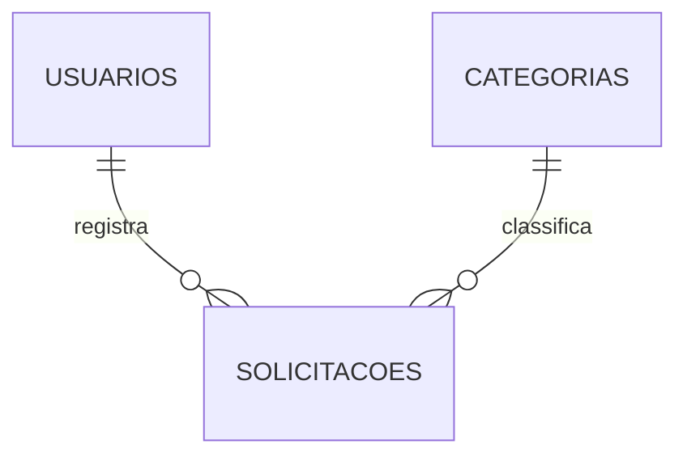

# Bairro em Dia

API CitizenTech para moradores registrarem problemas de zeladoria urbana e acompanharem o atendimento. Gestores administram categorias e atualizam status e prioridade.

## Integrante e pitch

Nome, RM e turma a preencher. Link do pitch a adicionar após a gravação.

## Executar

Requisitos locais: JDK 21 e Maven 3.9+.

```bash
mvn clean package
java -jar target/bairro-em-dia-1.0.0.jar
```

Swagger: http://localhost:8080/swagger-ui.html

O perfil local usa H2 em arquivo e preserva os dados em `data/`. Para PostgreSQL e Docker, copie `.env.example` para `.env`, substitua os valores e execute `docker compose up -d --build`.

| Papel | E-mail local | Senha fictícia local |
|---|---|---|
| GESTOR | gestor@bairro.test | GestorDemo123! |
| CIDADAO | cidadao@bairro.test | CidadaoDemo123! |

Faça login em `POST /api/auth/login`, copie `accessToken` e use **Authorize** no Swagger. O cadastro público cria cidadãos.

## Entidades



Solicitações têm autor e categoria obrigatórios, com `ManyToOne`, `LAZY` e chaves estrangeiras. A remoção de uma solicitação preserva seu autor e sua categoria. DTOs controlam os dados de entrada e saída. `@Version` trata alterações concorrentes.

## Consultas

| Tipo | Uso e justificativa |
|---|---|
| Query method | `findByEmail` para login, `countByCidadaoIdAndStatus` para contagem e `existsByCategoriaId` para verificar vínculos |
| JPQL | `contarPorStatus` agrega o resumo com filtro opcional de autor |
| Specification | Combina autor, categoria, status e título com paginação e ordenação |

O cidadão consulta suas próprias solicitações. O gestor consulta todas. Cache e Actuator foram dispensados conforme a orientação informada da disciplina.

## Instruções complementares

- [Endpoints e regras de negócio](docs/JAVA.md)
- [Azure, Docker e demonstração](docs/DEVOPS.md)
- [Índice das evidências](docs/evidencias/README.md)
