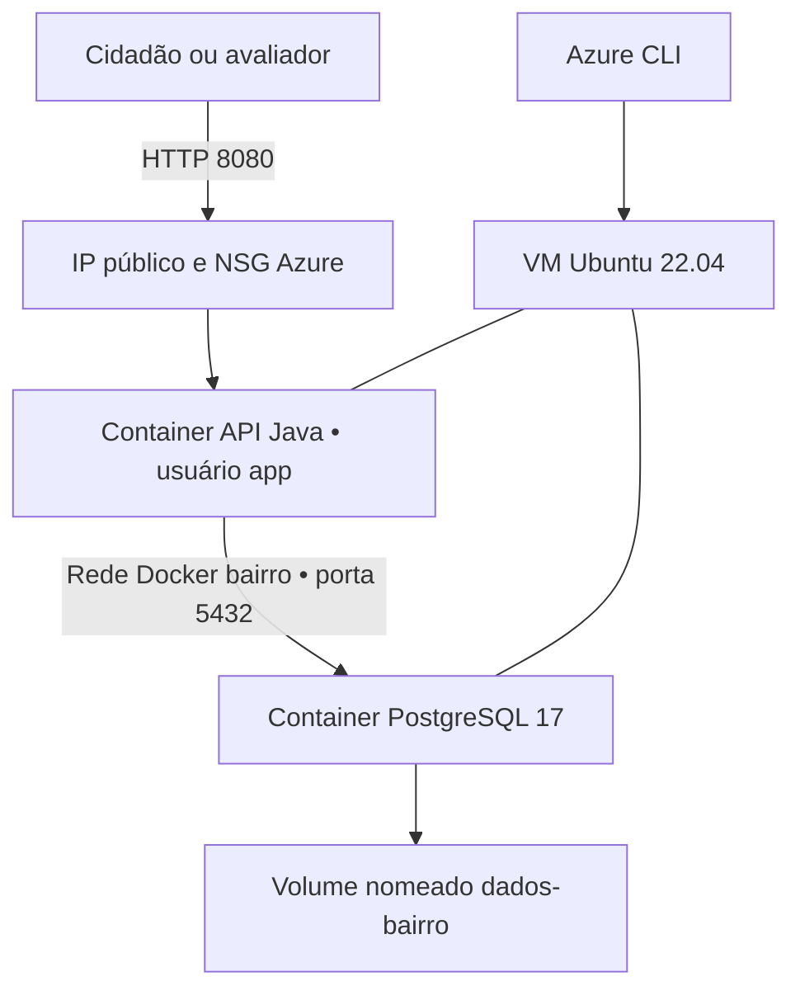

# DevOps • Bairro em Dia

## Arquitetura e justificativa



A VM hospeda API e banco com Docker Compose para permitir reproduzir o mesmo ambiente. A API usa Java 21 e Spring Boot. O PostgreSQL mantém os relacionamentos de usuários, categorias e solicitações. A rede Docker permite resolver `banco` por nome. O volume nomeado preserva os dados ao recriar containers. A aplicação roda como `app` e recebe as configurações por variáveis de ambiente. O banco expõe sua porta apenas no loopback do host. O NSG libera a porta 8080 da demonstração.

O script Azure CLI cria o grupo, a VM Ubuntu e a regra de rede. `az vm run-command invoke` instala Docker a partir do repositório oficial, clona o código, cria as configurações privadas e executa o Compose. Os comandos e resultados ficam no transcript, incluindo a criação real da VM.

## Provisionar no Azure Cloud Shell (Bash)

```bash
git clone https://github.com/AganeSenpai/BairroEmDia-Java.git
cd BairroEmDia-Java
az account show --query name -o tsv
LOCATION=brazilsouth VM_SIZE=Standard_D2s_v4 bash devops/provisionar-azure.sh
```

Escolha a assinatura correta antes de executar. Região e tamanho podem ser definidos por variáveis conforme a disponibilidade da assinatura. O script usa o grupo `rg-bairro-em-dia` e a VM `vm-bairro-em-dia`. A VM e os recursos associados consomem créditos enquanto existirem. A instalação e o build levam alguns minutos.

## Coletar evidências técnicas

```bash
bash devops/coletar-evidencias.sh
```

Os arquivos ficam em `~/bairro-evidencias`. Guarde também capturas legíveis dos comandos e resultados. O Cloud Shell efêmero perde arquivos ao encerrar a sessão, portanto baixe o pacote antes de sair.

Para executar comandos na VM pelo Cloud Shell, use `az vm run-command invoke -g rg-bairro-em-dia -n vm-bairro-em-dia --command-id RunShellScript --scripts 'COMANDO' --query 'value[].message' -o tsv`. O comando executa como administrador da VM. Os containers da API continuam com usuário não privilegiado.

## Demonstrar no vídeo

1. Mostre o script Azure CLI e a execução de criação, depois a VM no portal.
2. Abra o GitHub e mostre `Dockerfile`, `docker-compose.yml` e a pasta `devops`.
3. Mostre o diagrama e explique a comunicação API/banco e o volume.
4. Mostre `docker compose ps`, logs, `exec api id` e `exec api pwd` na VM.
5. Faça login no Swagger publicado e demonstre o CRUD de categoria e solicitação.
6. Execute um SELECT no PostgreSQL, consultando os registros criados pela API.
7. Recrie os containers com `docker compose down` e `docker compose up -d`; consulte o mesmo registro para comprovar persistência.

O vídeo deve ser narrado, legível, em 720p ou superior e publicado no YouTube como não listado. O PDF de entrega deve conter identificação, nome da solução e links do GitHub e vídeo. As capturas devem acompanhar as evidências reais.

## Credenciais da demonstração

O instalador gera senhas aleatórias e as mantém em `/opt/bairro/.env` na VM com permissão 600. Consulte-as somente em sessão privada quando precisar entrar no Swagger. Evite expor esse arquivo em prints, logs ou vídeo. O perfil local continua com os usuários fictícios documentados no README.

## Referências técnicas

- [Azure CLI e criação de VM](https://learn.microsoft.com/cli/azure/vm)
- [Docker Engine no Ubuntu](https://docs.docker.com/engine/install/ubuntu/)
