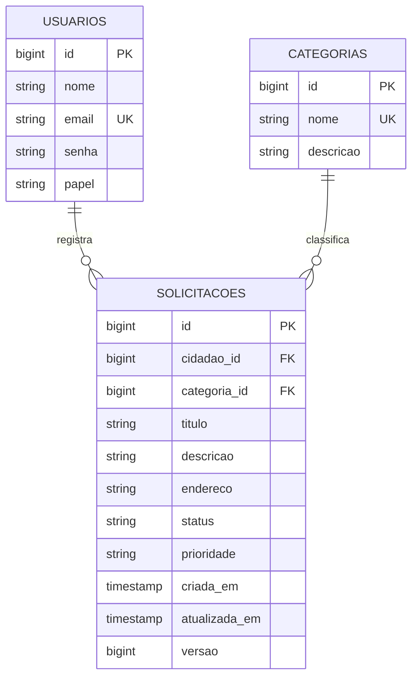

## Endpoints

| Método | Rota | Acesso e finalidade |
|---|---|---|
| POST | /api/auth/cadastro | Público, cadastro de cidadão |
| POST | /api/auth/login | Público, emissão de JWT |
| GET | /api/auth/me | Usuário autenticado |
| GET | /api/categorias | Autenticado, lista paginada |
| GET | /api/categorias/{id} | Autenticado, consulta individual |
| POST | /api/categorias | Gestor, criação |
| PUT | /api/categorias/{id} | Gestor, atualização |
| DELETE | /api/categorias/{id} | Gestor, exclusão sem vínculos |
| GET | /api/solicitacoes | Lista paginada e filtrada pelo acesso |
| GET | /api/solicitacoes/resumo | Contagens por status respeitando o acesso |
| GET | /api/solicitacoes/{id} | Dono ou gestor |
| POST | /api/solicitacoes | Autenticado, registro associado ao próprio usuário |
| PUT | /api/solicitacoes/{id} | Dono ou gestor, solicitação aberta |
| PATCH | /api/solicitacoes/{id}/atendimento | Gestor, status e prioridade |
| DELETE | /api/solicitacoes/{id} | Dono ou gestor, solicitação aberta |

Exemplo de criação de solicitação. Consulte primeiro uma categoria para obter o identificador existente.

```json
{
  "titulo": "Buraco na calçada",
  "descricao": "Calçada danificada próximo ao ponto de ônibus.",
  "endereco": "Rua de Demonstração, 150 - Centro",
  "categoriaId": 1
}
```

Exemplo de atendimento pelo gestor.

```json
{"status":"EM_ATENDIMENTO","prioridade":"ALTA"}
```

Os status disponíveis são `ABERTA`, `EM_ATENDIMENTO`, `RESOLVIDA` e `CANCELADA`. As prioridades são `BAIXA`, `MEDIA` e `ALTA`.

Filtros combináveis por `categoriaId`, `status` e `termo` (parte do título). Exemplo `GET /api/solicitacoes?status=ABERTA&termo=poste&page=0&size=10&sort=criadaEm,desc`. O limite de página é de 100 registros. Campos de ordenação permitidos estão descritos no Swagger. Os links paginados usam `self`, `first`, `next`, `prev` e `last` quando aplicáveis.

## Modelagem e relacionamentos



`Solicitacao` usa dois relacionamentos `ManyToOne`, com carregamento `LAZY` e chaves estrangeiras obrigatórias. O mapeamento para DTO ocorre dentro das transações. A associação não usa cascade de remoção, pois excluir uma solicitação deve preservar seu autor e sua categoria. O banco impede exclusões de registros referenciados. `@Version` detecta alterações concorrentes e a API responde 409 quando há conflito. Os DTOs impedem exposição do hash da senha.

## Regras de negócio e segurança

O cadastro público define sempre `CIDADAO`. O cliente não escolhe papel, autor, status inicial ou prioridade inicial. O usuário da solicitação vem do JWT. O cidadão consulta apenas seus próprios registros, inclusive nos filtros e no resumo. O gestor consulta todos e possui acesso às operações de categoria e atendimento.

Uma solicitação nasce `ABERTA`, com prioridade `MEDIA`. Seu conteúdo pode ser editado ou excluído enquanto estiver aberta. O atendimento segue `ABERTA → EM_ATENDIMENTO → RESOLVIDA`. O cancelamento pode ocorrer em `ABERTA` ou `EM_ATENDIMENTO`. Repetir o mesmo status é aceito e permite ajustar a prioridade. A API rejeita reabertura e conclusão direta de uma solicitação aberta.

As senhas são armazenadas com BCrypt. Os JWT têm emissor validado, assinatura HS256 e validade de uma hora. Envie o token no cabeçalho `Authorization: Bearer TOKEN`. CORS usa origens configuráveis por `CORS_ORIGINS`, separadas por vírgulas. As requisições são sem sessão. Use HTTPS no ambiente publicado.

Criação responde 201, com Location nos recursos de categoria e solicitação. Consultas e atualizações respondem 200, exclusões 204. Dados inválidos respondem 400, autenticação inválida 401, acesso negado 403, registro inexistente 404 e conflitos de negócio ou integridade 409. Os erros usam `application/problem+json`; erros de validação incluem os campos inválidos.

## Justificativa das consultas

| Consulta | Aplicação e motivo |
|---|---|
| Query method `findByEmail` | Login e busca por e-mail normalizado, com unicidade no banco |
| Query method `countByCidadaoIdAndStatus` | Contagem de abertas para o cidadão sem carregar registros completos |
| Query method `existsByCategoriaId` | Impede excluir uma categoria em uso |
| JPQL `contarPorStatus` | Agrega o resumo por status, com filtro opcional de autor |
| Specification `filtrar` | Combina autor, categoria, status e título sem criar métodos para cada combinação |

As consultas usam parâmetros. A pesquisa por título trata `%` e `_` como caracteres literais, e a ordenação aceita apenas campos listados. O banco possui índices nas chaves estrangeiras e no status para apoiar as consultas mais frequentes.

## HATEOAS

As respostas individuais contêm links para o próprio recurso, sua coleção e recursos relacionados. Os links de edição e exclusão de solicitações aparecem quando o status permite essas ações. O link de atendimento aparece para gestores. As categorias oferecem links para suas solicitações filtradas. A autorização também é conferida no servidor.

